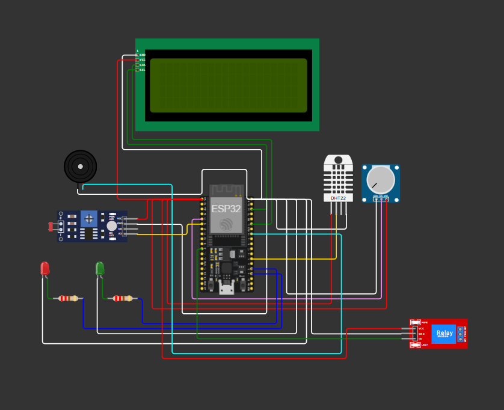
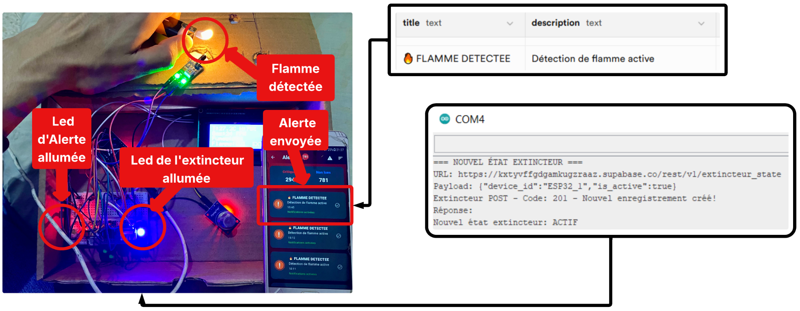

# AutoFlame Sentinel — Système d’alarme incendie

**AutoFlame Sentinel** est un projet de fin d’études consacré à la conception d’un système connecté de détection et d’alerte incendie. Il associe une carte ESP32, des capteurs environnementaux, une évaluation du risque par intelligence artificielle et une supervision à distance.

## Simulation Wokwi

[Ouvrir le projet « Système Alarme Incendie » dans Wokwi](https://wokwi.com/projects/422714056118944769)

## Montage

Le prototype s’appuie sur une carte ESP32-WROOM-32, un capteur de température et d’humidité DHT22, un capteur de flamme KY-026, des capteurs de fumée et de gaz MQ-2/MQ-6, ainsi qu’un écran LCD, des voyants, un buzzer et un actionneur d’extinction.

## Fonctionnement du système

1. **Mesure** — l’ESP32 recueille la température, l’humidité, la présence de flamme, la fumée et les gaz combustibles.
2. **Évaluation et alerte** — les mesures de température, d’humidité et de gaz alimentent le modèle TensorFlow Lite, qui estime un niveau de risque (`low`, `medium` ou `high`). L’écran LCD et les indicateurs locaux signalent l’état du système; le buzzer avertit en cas d’alerte.
3. **Transmission et supervision** — par Wi-Fi et API REST, les données et l’état du système sont transmis à Supabase. Les interfaces Flutter mobile et Web permettent de consulter les mesures, les graphiques et les alertes.
4. **Action** — en cas d’incendie détecté, le système active l’alarme et commande le dispositif d’extinction par électrovanne. L’état de l’extincteur est également suivi dans la base.

## Galerie du projet

Cliquez sur une image pour l’ouvrir en taille originale.

<table>
  <tr>
    <td align="center" valign="top" width="50%">
       
      <strong>Démarrage et connexion</strong> 
      L’écran LCD confirme la connexion Wi-Fi et l’état prêt du système.
    </td>
    <td align="center" valign="top" width="50%">
       
      <strong>Mesures et supervision</strong> 
      Les relevés sont transmis à Supabase et consultables dans l’application.
    </td>
  </tr>
  <tr>
    <td align="center" valign="top" width="50%">
       
      <strong>Détection et alerte</strong> 
      L’essai montre l’alerte locale, la notification mobile et l’état de l’extincteur.
    </td>
    <td align="center" valign="top" width="50%">
       
      <strong>Prototype final</strong> 
      Boîtier assemblé avec l’interface de supervision mobile.
    </td>
  </tr>
</table>

## Tests des matériels

Les sketches de test individuels des composants et les instructions de configuration sont disponibles dans le dossier [Tests pour les matériels](Testes%20pour%20les%20mat%C3%A9riels/README.md).

## Codes C++ du projet final

Les différentes versions des sketches Arduino/C++ sont regroupées dans le dossier [Les codes C++](Les%20codes%20C%2B%2B/README.md).

## Application mobile

Le code du dépôt [`smart_fire_alarm`](https://github.com/Bejaoui-Fedi/smart_fire_alarm), sa documentation et ses captures d’écran sont intégrés dans [Application mobile](Application%20mobile/README.md). L’application regroupe le tableau de bord, le suivi des capteurs, les alertes, l’analyse des risques et le pilotage des équipements.

## Modèle IA

Le modèle TensorFlow Lite et ses métadonnées sont disponibles dans le dossier [Modèle IA](mod%C3%A9le%20IA/README.md).

## Données Supabase

Une copie expurgée des fichiers de stockage est disponible dans [`kxtyvffgdgamkugzraaz.storage.sanitized.zip`](kxtyvffgdgamkugzraaz.storage.sanitized.zip). La photo personnelle de l’archive originale en a été retirée.

L’export SQL [schéma-seulement](db_cluster-29-07-2025-schema-only.sql.gz) contient les définitions de la base sans les enregistrements ni les valeurs de séquence. Les rôles et privilèges ont été retirés, les URL et jetons sensibles expurgés, et le déclencheur webhook propre au projet omis. Ce fichier n’est pas une sauvegarde complète restaurable : les rôles, privilèges et paramètres du webhook devront être recréés séparément. La sauvegarde brute n’est pas publiée.
